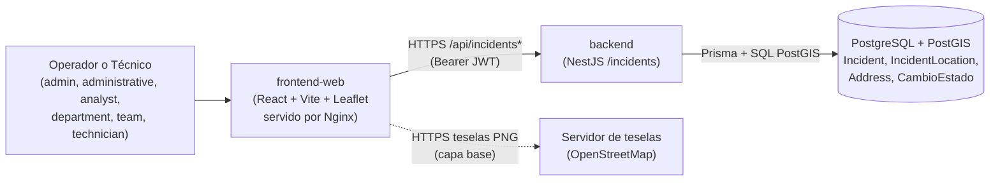
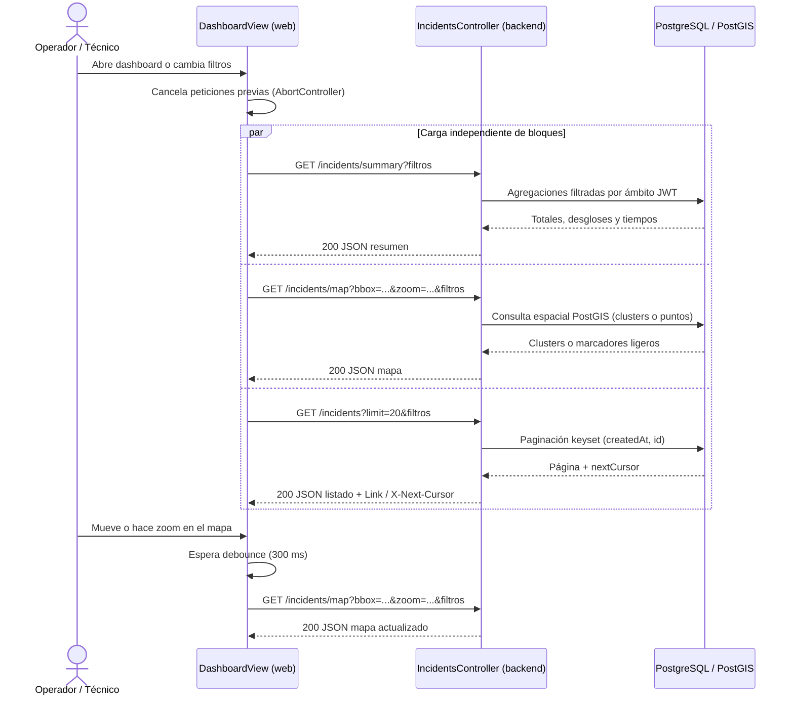

# DD-001 — Dashboard para operadores municipales y técnicos

| Metadato | Valor |
|---|---|
| Estado | Propuesto, pendiente de revisión |
| Autoría | Equipo 13, Alejandro Jiménez González |
| Fecha / última revisión | 2026-11-28 |
| Iteración | Fase 6: diseño de nuevas funcionalidades y refactorización |
| Revisores | Pendientes |
| Enlaces | Issues `#8`, `#15`, `#44`, `#173`; [ADR 0009](../adr/0009-arquitectura-dashboard-mapa-indicadores.md); [ADR 0004](../adr/0004-frontend-web-stack.md); [arquitectura](../architecture.md); [esquema Prisma](../../backend/prisma/schema.prisma); [contrato GET /incidents](../../backend/docs/spec/endpoint/get-incidents/README.md) |

## 1. Resumen ejecutivo

**Problema**

`frontend-web/` muestra hoy un listado paginado con filtros básicos y el detalle de cada incidencia, pero no tiene mapa ni indicadores generales. Además, `GET /incidents` solo abre la consulta global a `admin` y `administrative`, dejando fuera a `department`, `team`, `technician` y `analyst`. Con el volumen previsto de 50.000 incidencias tampoco es viable descargar coordenadas ni calcular agregados en el navegador.

**Solución propuesta**

Añadir al backend un endpoint geográfico por ventana visible (`bbox` y `zoom`) con clustering en servidor sobre PostgreSQL/PostGIS y un endpoint de indicadores agregados. Ambos comparten los filtros combinables y las reglas de visibilidad por ámbito con `GET /incidents`, ampliando el filtrado con distrito (`district`) y departamento (`departmentId`) e integrando mapa, indicadores y listado en `frontend-web/`.

**Razón principal**

Resolver el filtrado, la agrupación espacial y los agregados en el servidor evita peticiones N+1, acota cada respuesta ante 50.000 incidencias y garantiza que cada rol solo vea su ámbito con cifras coherentes entre los tres bloques.

**Principal riesgo**

Las consultas espaciales y de agregación con filtros combinados pueden cargar PostgreSQL si faltan índices o si se mueve el mapa muy rápido. Se controla con índices específicos, *debounce* y cancelación de peticiones en el cliente, degradación parcial entre bloques y pruebas `k6` sobre 50.000 filas.

## 2. Contexto y problema

En `origin/dev`, [frontend-web](../../frontend-web/README.md) es una SPA en React 19, TypeScript 5, Vite 8 y Tailwind CSS 3 ([ADR 0004](../adr/0004-frontend-web-stack.md)). Tiene tres pantallas gestionadas desde `frontend-web/src/App.tsx`: inicio de sesión (`LoginView`), listado paginado (`IncidentListView`) y detalle con validación, prioridad y asignación (`IncidentValidationView`).

El contrato vigente de [GET /incidents](../../backend/docs/spec/endpoint/get-incidents/README.md) acepta `status`, `priority`, `categoryId`, `from`, `to` y `order`, con paginación por cursor (`limit` de 1 a 100, 10 por defecto). Devuelve `id`, `title`, `status` y `createdAt`, sin coordenadas, prioridad, categoría, distrito ni total global. En [incidents.controller.ts](../../backend/src/incidents/incidents.controller.ts), solo `admin` y `administrative` pueden consultar el listado global; `department`, `team`, `technician` y `analyst` reciben `403` si no envían su propio `civicId`.

La base de datos desplegada ya usa PostgreSQL 16 con PostGIS (`imresamu/postgis:16-3.5-bookworm`, [despliegue](../deployment.md)). `IncidentLocation` guarda `latitude` y `longitude` como `Float` y referencia opcionalmente a `Address`, que tiene `district` (enum `AddressDistrict`, 11 distritos de Málaga). Al primer seed de [5.000 incidencias](../spec/features/20-11-26-poblar-incidencias-masivas/spec.md) se suma la ampliación a 50.000 de la PR #219.

Sin endpoints específicos de mapa e indicadores, operadores y técnicos no pueden localizar zonas críticas ni medir la carga por estado, prioridad, categoría o distrito. Calcularlo en el navegador desde `GET /incidents` obligaría a recorrer cientos de páginas y consultar `GET /incidents/:id` por cada fila para leer sus coordenadas.

## 3. Objetivos, no objetivos y alcance

**Objetivos**

- O1. Mostrar en `frontend-web/` un mapa interactivo con las incidencias del área consultada y acceso directo al detalle desde cada marcador.
- O2. Mostrar indicadores generales (total, reparto por estado, prioridad, categoría y distrito, y tiempos de resolución) calculados en servidor sobre el mismo conjunto filtrado.
- O3. Coordinar mapa, indicadores y listado con un estado único de filtros, sumando `district` y `departmentId` a los filtros ya integrados en servidor.
- O4. Habilitar el acceso al dashboard para `admin`, `administrative`, `analyst`, `department`, `team` y `technician` con visibilidad acotada por ámbito, manteniendo bloqueado el acceso de `civic`.
- O5. Soportar 50.000 incidencias con respuestas acotadas y sin romper los clientes actuales de `GET /incidents`.

**No objetivos**

- N1. Implementar el dashboard de auditoría ni el rol `auditor` (pertenece al microservicio de auditoría).
- N2. Añadir capas de datos abiertos o meteorología de AEMET en el mapa (pertenece al microservicio de datos externos).
- N3. Rediseñar la identidad visual o el logotipo de la web (`#169`).
- N4. Modificar el mapa de la aplicación móvil (`frontend-mobile/`, `#136`).

**Dentro del alcance:** `frontend-web/` (dashboard, mapa, indicadores y filtros unificados), `backend/` (ampliación de `GET /incidents`, endpoints de mapa e indicadores, reglas de ámbito por rol e índices en PostgreSQL/PostGIS) y escenarios `k6` en `backend/perf/`.

**Fuera del alcance:** microservicios de auditoría y datos externos, almacenamiento de fotos en S3 (`DD-002` en PR #220), unificación de reportes (`DD-003` en PR #220) y `frontend-mobile/`.

## 4. Requisitos y drivers arquitectónicos

| ID | Tipo | Necesidad / escenario | Criterio de aceptación y evidencia | Prioridad |
|---|---|---|---|---|
| RF-1 | Funcional | Mostrar incidencias en el mapa web agrupadas al alejar y como puntos al acercar | Al abrir el dashboard se pintan clusters o marcadores del `bbox` y al pulsar un punto se abre `IncidentValidationView` | Alta |
| RF-2 | Funcional | Consultar indicadores generales sincronizados con los filtros activos | Las cifras de `/incidents/summary` coinciden con consultas SQL directas para el mismo rol y filtros | Alta |
| RF-3 | Funcional | Combinar `status`, `priority`, `categoryId`, `from`, `to`, `district` y `departmentId` en los tres bloques | Cambiar un filtro actualiza mapa, indicadores y listado con los mismos parámetros; limpiar filtros restaura el estado inicial | Alta |
| RF-4 | Funcional | Acceso acotado por ámbito para operadores y técnicos | Tests de integración confirman que cada rol recibe solo su ámbito y que `civic` recibe `403` en mapa e indicadores | Alta |
| RF-5 | Funcional | Mantener compatibilidad de `GET /incidents` con clientes actuales | La suite actual de backend y el listado ciudadano móvil pasan sin cambios de contrato | Alta |
| RQ-1 | Calidad | Responder con fluidez sobre 50.000 incidencias al mover el mapa o filtrar | Prueba `k6` sobre 50.000 filas contra los tres endpoints. Umbral interno propuesto a calibrar con la línea base: p95 < 500 ms con 10 VUs (no fijado por el enunciado) | Alta |
| RQ-2 | Calidad | Degradación parcial si falla un endpoint del dashboard o el servidor de teselas | Si fallan los indicadores, el mapa o las teselas OSM, el listado sigue usable y el bloque afectado muestra aviso y botón de reintento | Alta |
| RQ-3 | Calidad | Evitar acceso fuera de ámbito o exposición de datos personales ciudadanos | Forzar un `departmentId` ajeno devuelve `403`; mapa e indicadores no devuelven PII del ciudadano | Alta |
| RQ-4 | Calidad | Acotar siempre el tamaño de respuesta por petición | `GET /incidents` mantiene `limit <= 100` y `GET /incidents/map` aplica tope máximo de puntos | Alta |
| RC-1 | Restricción | Mantener el stack actual (React 19, Vite 8, Tailwind 3, NestJS, Prisma, PostgreSQL/PostGIS) | Verificado en `package.json`, `docker-compose.yml` y CI | Alta |
| RC-2 | Restricción | Sin dependencias de APIs de mapas comerciales de pago | Uso de Leaflet y teselas OSM configurables por variable de entorno | Media |
| RC-3 | Restricción | Compatibilidad con trazabilidad por UUID y futura unificación (`DD-003`) | Identificadores UUID en contratos y consultas encapsuladas para migrar a incidencias normalizadas | Media |

El objetivo de p95 en `RQ-1` es una meta interna propuesta para guiar las pruebas; se revisará con mediciones reales de `backend/perf/baseline.js` en la nube con las 50.000 incidencias.

## 5. Arquitectura actual y dependencias

La visión general del sistema está en [architecture.md](../architecture.md) y en el [diagrama C4 existente](../../backend/docs/c4/c4.drawio_1.png).

En `frontend-web/`, tras `POST /auth/login` se abre `IncidentListView`, que llama a `GET /categories` y `GET /incidents` a través de `/api` (proxy de Vite en local y Nginx en Docker Compose). Al elegir una fila se consulta `GET /incidents/:id` y se abre `IncidentValidationView`.

En `backend/`, `AccesoIncidenciasGuard` valida el JWT y carga el usuario con su membresía de departamento (`departmentMembership`), su equipo (`teamMemberships[0]`), `esTecnico` y `ciudadanoId`. Pese a tener esos datos cargados, `IncidentsController.listar()` hoy solo autoriza el listado global a `admin` y `administrative`.

El diseño depende de PostgreSQL 16 con PostGIS (`database`), Prisma (más SQL parametrizado `$queryRaw` para consultas espaciales), un servidor externo de teselas OpenStreetMap consumido desde el navegador y, a futuro, de la normalización de direcciones (PR #211, `#210`) y de la unificación de reportes (`DD-003`, PR #220).

## 6. Alternativas consideradas

| Alternativa | Descripción | Ventajas | Inconvenientes / riesgos | Evidencia disponible |
|---|---|---|---|---|
| A. Reutilizar `GET /incidents` + `GET /incidents/:id` en cliente | Paginar el listado, pedir el detalle de cada incidencia para leer coordenadas y calcular mapa e indicadores en navegador | Sin endpoints nuevos en backend | Miles de peticiones N+1 con 50.000 filas; indicadores limitados a lo descargado; bloqueo del navegador | Verificado en [contrato GET /incidents](../../backend/docs/spec/endpoint/get-incidents/README.md) (`limit <= 100`, sin coordenadas) |
| B. Endpoint plano de coordenadas y clustering en cliente | Servir `(id, lat, lon, status)` con un límite fijo y agrupar con Leaflet + Supercluster en navegador; KPIs en servidor | Backend más sencillo sin lógica espacial | Con 50.000 incidencias en vista completa de Málaga transfiere megabytes o trunca puntos de forma sesgada | Volumen de 50.000 incidencias en PR #219 |
| C. Mapa por `bbox` + `zoom` con clustering en servidor/PostGIS e indicadores en servidor (propuesta) | Devolver clusters agregados en PostGIS en zooms lejanos y puntos ligeros en zooms cercanos, junto a `/incidents/summary` con los mismos filtros y ámbito que `GET /incidents` | Respuestas acotadas con cualquier volumen; cifras exactas sobre toda la BD; reutiliza PostGIS ya desplegado; mantiene compatible `GET /incidents` | Añade consultas SQL espaciales, índices nuevos y dos contratos más que mantener | `imresamu/postgis:16-3.5-bookworm` ya en [despliegue](../deployment.md); `k6` en `backend/perf/` |

Los criterios de comparación son comportamiento con 50.000 incidencias, exactitud de indicadores, tamaño de respuesta, control de ámbito por rol, coste y mantenibilidad.

Se propone la **Alternativa C** ([ADR 0009](../adr/0009-arquitectura-dashboard-mapa-indicadores.md)). La Alternativa A es inviable con 50.000 incidencias. La Alternativa B obliga a truncar el mapa en vistas generales de la ciudad o penaliza la red. La Alternativa C aprovecha PostGIS sin añadir contenedores ni costes externos y mantiene respuestas pequeñas en todos los niveles de zoom.

## 7. Diseño propuesto

### 7.1. Visión y diagramas C4

- Contexto (L1): sin cambios estructurales respecto a [architecture.md](../architecture.md), ampliando el acceso web a `department`, `team`, `technician` y `analyst` e incorporando la descarga directa de teselas cartográficas desde OpenStreetMap por el navegador.
- Contenedores (L2): se mantienen `frontend-web` (Nginx + SPA), `backend` (NestJS) y `database` (PostgreSQL/PostGIS).
- Componentes (L3): en `backend/src/incidents/` se extrae un constructor compartido de filtros y ámbito por rol consumido por `listarPagina`, `MapaIncidenciasService` y `ResumenIncidenciasService`. En `frontend-web/src/`, `DashboardView` comparte el estado de filtros entre `DashboardKpis`, `IncidentMapPanel` e `IncidentListPanel`.



Flujo al abrir el dashboard, cambiar filtros o mover el mapa:



### 7.2. Interfaces y contratos

Todos los endpoints del dashboard exigen `Authorization: Bearer <JWT>` y aceptan estos filtros opcionales combinables (intersección `AND`):

| Parámetro | Valores válidos | Estado |
|---|---|---|
| `status` | Enum `IncidentStatus` | Implementado en `GET /incidents` |
| `priority` | `low`, `medium`, `high` | Implementado en `GET /incidents` |
| `categoryId` | UUID v4 de `Category` | Implementado en `GET /incidents` |
| `from`, `to` | `AAAA-MM-DD` (UTC, `from <= to`) | Implementado en `GET /incidents` |
| `district` | Enum `AddressDistrict` (11 distritos de Málaga) | Propuesto |
| `departmentId` | UUID v4 de `Department` (sujeto a reglas de ámbito) | Propuesto |

**Ampliación compatible de `GET /incidents`**

Acepta `district` y `departmentId`, incluyéndolos dentro del cursor para conservar la comprobación de coherencia. Mantiene el cuerpo como array de resúmenes (`id`, `title`, `status`, `createdAt`) y las cabeceras `X-Page`, `X-Limit`, `X-Next-Cursor` y `Link`. Abre la consulta sin `civicId` a `department`, `team`, `technician` y `analyst` dentro de su ámbito, sin alterar el comportamiento de `civic`.

**`GET /incidents/map` (propuesto)**

Recibe `bbox=minLon,minLat,maxLon,maxLat` (WGS84, `minLon < maxLon`, `minLat < maxLat`), `zoom` (entero `0..22`), `maxPoints` opcional (500 por defecto, máximo 1.000) y los filtros comunes. Con `zoom < 15` devuelve agrupaciones por rejilla espacial; con `zoom >= 15` devuelve puntos individuales si el recuento en el área no supera `maxPoints` (si lo supera, mantiene clusters o marca `truncated: true`).

```json
{
  "mode": "clusters",
  "totalInBounds": 1842,
  "truncated": false,
  "clusters": [
    {
      "id": "z13:36.718:-4.421",
      "latitude": 36.7196,
      "longitude": -4.4216,
      "count": 143,
      "bounds": [-4.431, 36.712, -4.411, 36.726],
      "byStatus": { "reported": 41, "validated": 38, "in_progress": 34, "resolved": 30 }
    }
  ],
  "points": []
}
```

Cuando `mode` es `"points"`, cada elemento de `points` incluye `id` (UUID), `title`, `status`, `priority`, `categoryId`, `latitude`, `longitude` y `createdAt`.

**`GET /incidents/summary` (propuesto)**

Recibe los filtros comunes (y opcionalmente `bbox` si el equipo acuerda sincronizar KPIs con la vista del mapa, cuestión `Q-2`):

```json
{
  "total": 1240,
  "openCount": 780,
  "resolvedCount": 460,
  "byStatus": { "reported": 210, "validated": 180, "assigned": 160, "in_progress": 190, "reopened": 40, "resolved": 310, "closed": 120, "rejected": 30 },
  "byPriority": { "low": 520, "medium": 480, "high": 240 },
  "byCategory": [{ "categoryId": "...", "name": "Alumbrado", "count": 320 }],
  "byDistrict": [{ "district": "centro", "count": 215 }, { "district": null, "count": 18 }],
  "resolutionTimeHours": { "sampleSize": 430, "average": 38.4, "median": 24.0 }
}
```

Para poblar los selectores de filtros se reutiliza `GET /categories`, el enum fijo `AddressDistrict` y una consulta ligera de departamentos activos accesible para roles globales (incluyendo `analyst`, que hoy no accede a `GET /incidents/assignment-options`).

Los tres endpoints son lecturas `GET` idempotentes. Devuelven `400` ante parámetros desconocidos o mal formados, `401` sin JWT válido, `403` si el rol o el ámbito no están autorizados y `503` si PostgreSQL no responde. Los contratos se documentarán en Swagger y en `backend/docs/spec/endpoint/`.

### 7.3. Modelo y gestión de datos

La titularidad permanece en PostgreSQL dentro de `backend/`, leyendo `Incident`, `IncidentLocation`, `Address`, `Category`, `Department` y `CambioEstado` sin crear tablas de negocio nuevas.

Como `Incident` no tiene columna `resolvedAt`, el tiempo de resolución se calcula en SQL entre `Incident.createdAt` y el cambio correspondiente en `CambioEstado` (`status_changes`). Si las pruebas `k6` sobre 50.000 filas muestran que ese join penaliza `/incidents/summary`, se añadirá en una migración posterior una columna `resolvedAt` en `Incident` actualizada en la misma transacción del cambio de estado.

Sobre los índices actuales de `schema.prisma`, se propone añadir mediante migración Prisma:

- `Incident(createdAt, id)`, `Incident(status, createdAt)` e `Incident(priority, createdAt)`.
- `Address(district)` y `CambioEstado(incident_id, new_status, created_at)`.
- Activación de la extensión `postgis` y columna generada `geom geometry(Point, 4326)` en `IncidentLocation` a partir de `longitude` y `latitude` con índice `GIST(geom)`, que permite usar `ST_MakeEnvelope` y `ST_SnapToGrid` sin modificar los puntos de escritura de Prisma.

En el seed masivo todas las incidencias tienen `Address` y distrito, pero en `POST /incidents` la dirección es opcional. Las incidencias sin `addressId` se contabilizan bajo `district: null` ("Sin distrito") y quedan excluidas al filtrar por un distrito concreto hasta que se integre la geocodificación (`#210`). Cuando entre `DD-003` (unificación de reportes), estos servicios deberán leer incidencias normalizadas para no contar varias veces el mismo problema.

### 7.4. Fallos, concurrencia y resiliencia

Indicadores, mapa y listado lanzan peticiones independientes. Si `/incidents/summary` falla o agota timeout, el mapa y el listado siguen operativos y solo el bloque de indicadores muestra el error con un botón de reintento. Si falla `/incidents/map` o deja de responder el servidor de teselas OpenStreetMap, el listado continúa disponible y la zona del mapa informa del problema.

Al cambiar filtros o desplazar el mapa se cancelan las peticiones anteriores con `AbortController` para evitar respuestas fuera de orden. El movimiento y zoom del mapa aplican un *debounce* de 300 ms antes de llamar a `/incidents/map`. En el cliente se mantiene `fetchWithTimeout` y la detección de `502`/`503`/`504` de `frontend-web/src/services/http.ts`; en PostgreSQL conviene fijar un `statement_timeout` acotado para consultas agregadas o espaciales.

Al tratarse de tres lecturas paralelas sobre un sistema vivo, un alta o cambio de estado entre llamadas puede provocar una diferencia puntual de una unidad entre paneles hasta el siguiente refresco, un comportamiento aceptable en operación municipal. No se realizan reintentos automáticos ante `400`, `401` o `403`.

### 7.5. Seguridad

El backend construye siempre la restricción de ámbito a partir del usuario resuelto por `AccesoIncidenciasGuard` (JWT verificado y membresías activas en PostgreSQL), sin confiar en filtros del navegador:

| Rol (`profile_role`) | Ámbito en listado, mapa e indicadores | Filtro `departmentId` | Acciones de gestión |
|---|---|---|---|
| `admin`, `administrative` | Global | Permitido | Validación, prioridad y asignación actuales |
| `analyst` | Global (solo lectura) | Permitido | Ninguna mutación |
| `department` | Solo su departamento activo (`departmentId`) | `403` si pide otro | Según reglas actuales de departamento |
| `team` | Solo su equipo activo (`teamId`) | `403` si fuerza otro | Según reglas actuales de equipo |
| `technician` | Solo sus incidencias asignadas (`technicianId`) | `403` si fuerza otro | Solo sobre sus asignadas |
| `civic` | `403` en mapa e indicadores; en `GET /incidents` sigue limitado a `civicId` propio | No permitido | Alta y consulta ciudadana |

Si un usuario `department` o `team` no tiene membresía activa en `DepartmentMember` o `TeamMember`, recibe `403` en lugar de abrir una consulta sin filtro. Ni `/incidents/map` ni `/incidents/summary` incluyen `civicId`, nombre, correo, teléfono ni imágenes privadas. Todos los parámetros (`bbox`, `zoom`, UUIDs, fechas y enums) se validan en un `PipeTransform` estricto antes de pasar a Prisma o a SQL parametrizado.

### 7.6. Operación y despliegue

Se mantiene la topología de Docker Compose (`frontend-web` con Nginx reenviando `/api/` al `backend`, y `database` PostGIS), compatible con un despliegue posterior en AWS (SPA en S3/CloudFront o contenedor, API en ECS/EC2 y PostgreSQL/PostGIS en RDS o contenedor).

En `frontend-web/` se propone `leaflet` (con `@types/leaflet`) y teselas OpenStreetMap configurables mediante `VITE_MAP_TILE_URL` y `VITE_MAP_TILE_ATTRIBUTION` para poder cambiar de proveedor sin tocar código. La navegación puede quedarse inicialmente en `App.tsx` (alternando `DashboardView` e `IncidentValidationView`); la introducción de un enrutador se deja para cuando crezcan las vistas, como indica el [ADR 0004](../adr/0004-frontend-web-stack.md).

Para observabilidad se registrarán logs estructurados con ruta, rol, duración, elementos devueltos y modo del mapa (`clusters` o `points`), y se añadirán `incidents_map` e `incidents_summary` a `backend/perf/baseline.js` y `stress.js`. Las consultas se ejecutan inicialmente directas sobre PostgreSQL indexado; si `k6` detecta carga alta en `/incidents/summary`, se evaluará una caché corta (por ejemplo 30 s) segmentada por ámbito y filtros. No hay costes adicionales de licencias, y la reversión consiste en retirar la vista y las dos rutas nuevas sin cambios destructivos en datos ni contratos previos.

## 8. Decisiones y trade-offs

| Decisión propuesta | Beneficio | Coste / consecuencia | ¿Requiere ADR? |
|---|---|---|---|
| Mapa por `bbox` + `zoom` con clustering en servidor/PostGIS e indicadores agregados en servidor | Respuestas acotadas con 50.000 incidencias y métricas exactas sobre toda la BD | Consultas SQL espaciales, migración de índices y dos endpoints más | Sí: [ADR 0009](../adr/0009-arquitectura-dashboard-mapa-indicadores.md) (propuesto) |
| Visibilidad acotada por ámbito organizativo en servidor | Principio de mínimo privilegio y acceso operativo para `department`, `team`, `technician` y `analyst` | Ampliar pruebas de autorización y validar membresías activas | Sí, en [ADR 0009](../adr/0009-arquitectura-dashboard-mapa-indicadores.md) |
| Añadir `district` y `departmentId` como filtros compartidos | Cubre filtrado territorial y organizativo (`#44`, `#15`) | Incidencias sin `Address` no entran al filtrar por distrito hasta completar `#210` | No (extensión compatible) |
| Usar Leaflet + teselas OSM configurables en `frontend-web/` | Sin claves de facturación ni bloqueo a un proveedor comercial | Sujeto a política de uso de OSM y a fallos del servidor de teselas | Pendiente de decidir al implementar |
| Mantener la navegación actual en `App.tsx` en esta fase | Evita mezclar un enrutador nuevo con el dashboard | Los filtros activos aún no se reflejan en la URL | No (ya previsto en [ADR 0004](../adr/0004-frontend-web-stack.md)) |

El [ADR 0009](../adr/0009-arquitectura-dashboard-mapa-indicadores.md) documenta la propuesta principal y queda pendiente de revisión.

## 9. Plan de implementación y migración

1. Validar con el equipo y el profesorado las reglas de ámbito (especialmente `technician` y `analyst`) y el formato JSON de `/incidents/map` y `/incidents/summary`.
2. Crear la migración Prisma con `postgis`, columna generada `geom` e índice `GIST` en `IncidentLocation`, más los índices en `Incident`, `Address` y `CambioEstado`, y probarla sobre 50.000 incidencias.
3. Extraer en backend la lógica compartida de filtros y ámbito, ampliar `GET /incidents` (`district`, `departmentId` y roles municipales) e implementar `GET /incidents/map` y `GET /incidents/summary` con tests unitarios e integración.
4. Integrar en `frontend-web/` Leaflet, `DashboardKpis`, `IncidentMapPanel` y `IncidentFilters` ampliado junto al listado, con *debounce*, `AbortController` y degradación parcial.
5. Añadir `/incidents/map` y `/incidents/summary` a `backend/perf/baseline.js` y `stress.js`, medir sobre 50.000 incidencias y decidir si hace falta `resolvedAt` o caché corta.
6. Si se requiere reversión tras desplegar, desactivar la nueva vista y retirar las dos rutas nuevas; el listado anterior y los datos persistidos no sufren cambios incompatibles.

**Dependencias:** ampliación del seed a 50.000 incidencias (PR #219) para pruebas realistas de carga; geocodificación de direcciones (`#210`, PR #211) para asignar `district` a incidencias nuevas sin dirección; coordinación futura con `DD-003` (PR #220) al introducir incidencias normalizadas.

**Impacto en versiones anteriores:** ninguno en `frontend-mobile/` ni en consumidores existentes de `GET /incidents`, ya que los nuevos filtros son opcionales y el cuerpo de respuesta no cambia.

## 10. Estrategia de verificación y evaluación

| Requisito | Prueba / experimento | Entorno y datos | Métrica / umbral | Evidencia esperada |
|---|---|---|---|---|
| RF-1 | Tests unitarios de `MapaIncidenciasService`, tests en Vitest con mapa simulado y prueba manual en Málaga | Local / CI y BD con 50.000 filas | Clusters con `zoom < 15`, marcadores con `zoom >= 15` y apertura de detalle | Suites en verde y acta de prueba |
| RF-2 y RF-3 | Tests de integración comparando `/incidents/summary` y `/incidents` frente a SQL directo con combinaciones de los 7 filtros | Local con PostgreSQL (5.000 y 50.000 filas) | Diferencia 0 entre API y SQL | Tests de integración en CI |
| RF-4 y RQ-3 | Matriz de pruebas con JWT de los 7 roles e intentos de forzar `departmentId` ajeno | Local / CI con usuarios y membresías reales | 100 % de accesos indebidos en `403`; 0 campos PII en respuestas | Tests de autorización en CI |
| RF-5 | Suite completa actual de `backend/` y `frontend-web/` | GitHub Actions | 0 regresiones | Workflows de CI en verde |
| RQ-1 y RQ-4 | `k6` (`baseline.js` y `stress.js`) sobre `/incidents/map`, `/incidents/summary` y `/incidents` filtrados | Cloud real con 50.000 incidencias | p50, p95, p99, tasa de error y CPU de BD (objetivo interno propuesto: p95 < 500 ms con 10 VUs) | `baseline_resultados.md` y paneles Grafana |
| RQ-2 | Fallo inyectado (`503` en `/incidents/summary` y bloqueo de teselas OSM) | Local y pruebas | Listado operativo; aviso con reintento en el bloque afectado | Tests Vitest y prueba manual |

La corrección de filtros, permisos, agregados y degradación en interfaz se valida en local y en CI. La latencia real con 50.000 filas bajo concurrencia, el plan de consulta de PostGIS en el hardware real, el proxy Nginx y la respuesta de teselas externas solo pueden validarse en el despliegue real en la nube.

## 11. Riesgos, hipótesis y cuestiones abiertas

| ID | Tipo | Descripción | Impacto | Acción y responsable |
|---|---|---|---|---|
| H-1 | Hipótesis | El corte en `zoom >= 15` separa vistas generales de Málaga de vistas de calle con un número manejable de puntos | Umbral demasiado bajo devuelve demasiados marcadores; demasiado alto obliga a hacer mucho zoom | Ajustar sobre las 50.000 incidencias del seed (Frontend Web + Backend) |
| H-2 | Hipótesis | Calcular `resolutionTimeHours` con join sobre `status_changes` es suficientemente rápido con el índice compuesto | Puede penalizar `/incidents/summary` bajo carga | Medir con `k6` sobre 50.000 filas y valorar columna `resolvedAt` (Backend) |
| R-1 | Riesgo | Movimientos rápidos del mapa saturan PostgreSQL | Mayor latencia global de la API | *Debounce* 300 ms, `AbortController`, índice `GIST`, `statement_timeout` y validación `k6` (Frontend Web + Backend) |
| R-2 | Riesgo | Incidencias creadas sin `address` no tienen `district` hasta integrar `#210` | Quedan fuera al filtrar por distrito | Mostrar "Sin distrito" en indicadores y coordinar con PR #211 (Equipo) |
| R-3 | Riesgo | OpenStreetMap aplica límites de tráfico o cae temporalmente | Desaparece el fondo cartográfico | Parametrizar `VITE_MAP_TILE_URL` y aislar el fallo del listado (Frontend Web) |
| R-4 | Riesgo | Ampliar `GET /incidents` filtra incidencias entre departamentos o técnicos | Fuga de datos entre ámbitos | Probar matriz completa de roles y exigir membresía activa (Backend) |
| R-5 | Riesgo | Al entrar `DD-003` se cuentan reportes en vez de incidencias normalizadas | Indicadores duplicados | Migrar los servicios de lectura del dashboard junto a `DD-003` (Backend) |
| Q-1 | Pregunta | ¿`technician` ve solo sus asignadas o también en solo lectura las de su equipo? | Cambia la regla de ámbito del técnico | Acordar con equipo y cliente antes de implementar |
| Q-2 | Pregunta | ¿`/incidents/summary` muestra siempre el total filtrado o permite acotarse al `bbox` del mapa? | Cambia el comportamiento al mover el mapa y el tráfico al backend | Decidir con el equipo antes de cerrar el contrato |
| Q-3 | Pregunta | ¿El tiempo de resolución se mide hasta `resolved` o hasta `closed` (y cómo cuenta `reopened`)? | Cambia la fórmula del indicador | Acordar definición con equipo y cliente |
| Q-4 | Pregunta | ¿Se incluye búsqueda por texto (`search`) o filtros `teamId`/`technicianId` en esta iteración? | Amplía el alcance del backend y de `IncidentFilters` | Decidir alcance de iteración con el equipo |

## 12. Revisión y resultado

- **Comentarios de revisión:** pendiente de revisión por el equipo y de validación por el profesorado como cliente.
- **Resolución:** propuesta preliminar pendiente de revisión.
- **Decisiones registradas:** [ADR 0009](../adr/0009-arquitectura-dashboard-mapa-indicadores.md) (propuesto, pendiente de revisión).
- **Diferencias observadas tras implementar:** aún no aplica; solo están integrados en `dev` el listado paginado y los cinco filtros iniciales.

## Checklist de aprobación

- [x] Problema y alcance delimitados.
- [x] Drivers y restricciones documentados, sin atribuir al enunciado requisitos inexistentes.
- [x] Al menos dos alternativas comparadas o justificación de por qué no hay alternativas viables.
- [x] Diagramas, datos y contratos coherentes con el código vigente.
- [x] Fallos, seguridad, operación y costes considerados en proporción al cambio.
- [x] Criterios de aceptación verificables y plan de pruebas reproducible.
- [x] Riesgos y cuestiones abiertas explícitos.
- [ ] Revisión técnica realizada por el equipo y validación del cliente; ADR aprobado.
